# EL DESPACHO — Simulador presidencial

Eres el nuevo presidente de la República de Valdoria. Tienes una legislatura para gobernar,
sobrevivir a las crisis, negociar con el mundo y ganar la reelección. Todo ocurre desde tu despacho.

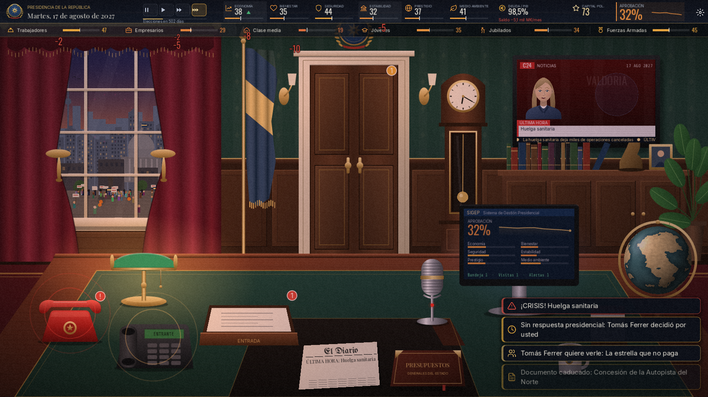

| | |
|---|---|
| 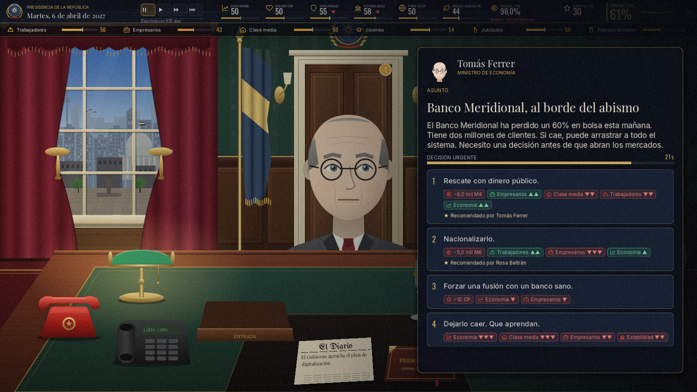 | 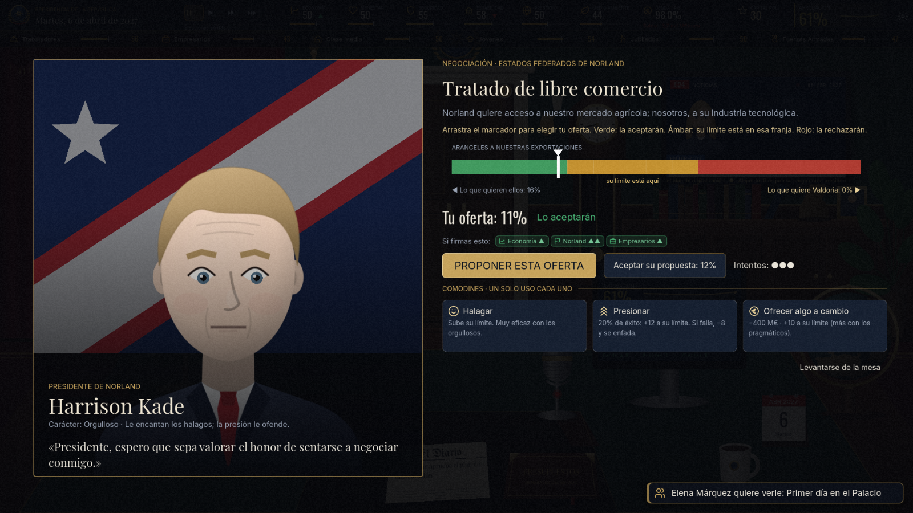 |
| 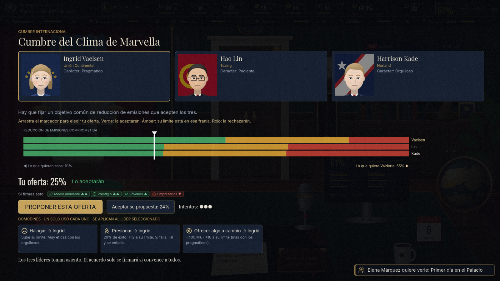 | 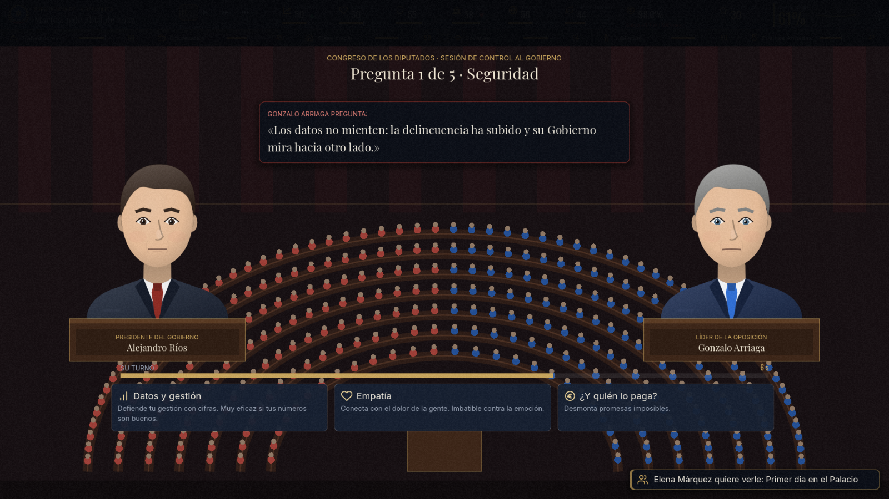 |
| 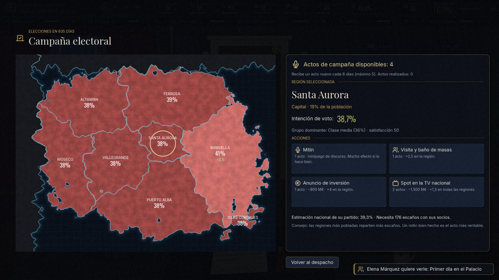 | 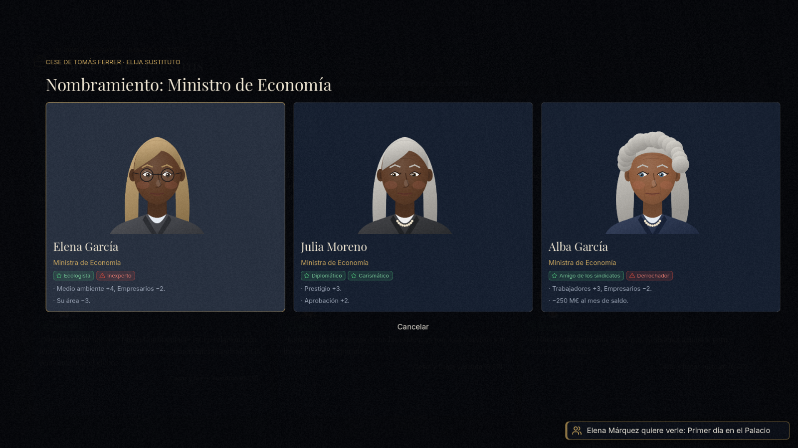 |
| 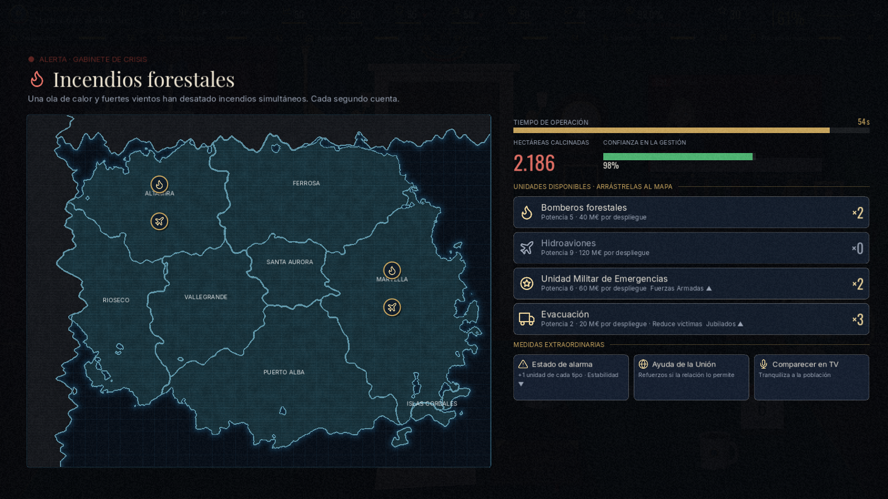 | 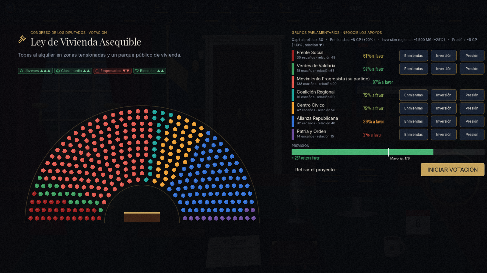 |
| 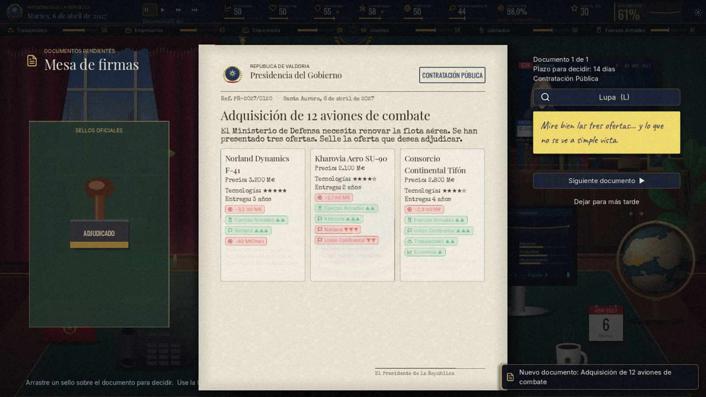 | 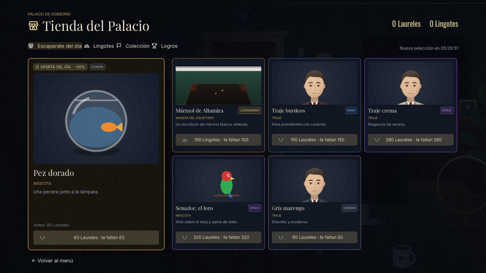 |

## Novedades: el despacho en 3D

- **El despacho es ahora un espacio 3D en primera persona**: empiezas sentado en el sillón presidencial,
  puedes mirar a tu alrededor con el ratón y **levantarte para andar** por toda la sala (chimenea,
  librerías, sofá, ventana con vistas a la ciudad, banderas, mapa del mundo, reloj de pie...).
- **Objetos con físicas**: el periódico, los teléfonos, la carpeta, la taza, el calendario, las plumas,
  el sello, los libros, los cojines... se pueden coger, lanzar y tirar al suelo. Hay una papelera
  donde encestar bolas de papel. Los teléfonos dan saltitos sobre la mesa cuando suenan.
- Los visitantes **entran por la puerta** y caminan hasta tu mesa; el retrato oficial que cuelga sobre
  la chimenea es el tuyo.
- Los minijuegos y paneles siguen siendo los mismos (en 2D, por encima del despacho).
- En **Opciones** puedes volver al despacho 2D clásico, ajustar la sensibilidad del ratón y activar
  los **gráficos 3D reducidos** (se activan solos en equipos sin aceleración gráfica, como máquinas virtuales).

| Control | Acción |
|---|---|
| Ratón | Mirar |
| Clic | Usar el objeto apuntado (abre su panel) |
| Clic derecho | Coger / soltar un objeto (con un objeto en la mano, clic para lanzarlo; rueda para acercarlo) |
| WASD / flechas | Levantarse y andar (Mayús: correr) |
| F | Sentarse / levantarse (o clic en el sillón) |
| R | Ordenar la mesa (todo vuelve a su sitio) |
| Tab | Liberar el cursor para usar los botones de la barra superior |
| H | Mostrar u ocultar la ayuda de controles |

## Novedades de la versión 2.0

- **Tres modos de juego**: *Clásico* (una legislatura), *Infinito* (legislaturas encadenadas hasta
  que dejen de votarte, con récord de años en el poder) y *Meme* (política de chiste).
- **Dificultades que cambian la forma de jugar**, no solo los números (ver más abajo).
- **Cada partida es distinta**: escenario inicial, tramas sorteadas, mundo aleatorio y memoria de
  lo que salió en tus últimas partidas. Más de 200 eventos (antes, 139).
- **Equilibrio revisado**: las decisiones dejan huella durante meses, la corrupción acaba en
  escándalos, cada ley encarece la siguiente y ningún grupo social se dispara al 99 % ni cae al 1 %.
- **Nueva barra superior** con el estilo del despacho (madera, latón y tipografía clásica) y avisos
  que ya no tapan la mesa.

## Cómo jugar

- Necesitas **[Godot 4.7](https://godotengine.org/download)** (versión estándar, no .NET).
- Abre `project.godot` con Godot y pulsa **F5**. En Windows basta con hacer doble clic en
  `Jugar.bat`: busca Godot en `%USERPROFILE%\Godot\` y en la carpeta de Descargas.
- **F11**: pantalla completa · **Espacio**: pausa · **1 / 2 / 3**: velocidad · **Esc**: menú.
- Usa el renderizador *Compatibility*, así que funciona incluso en equipos sin tarjeta gráfica dedicada.

## Modos de juego

| Modo | Cómo es |
|---|---|
| Clásico | Una legislatura de 1, 2 o 4 años. Gana la reelección. |
| Infinito | Legislaturas de 4 años, una tras otra. Si ganas, el Congreso sale de las urnas, llegan tramas nuevas y la oposición puede cambiar de líder. Cada legislatura pesa más que la anterior (fatiga y ganas de cambio), así que siempre hay un final. Tu récord de años en el poder queda guardado. |
| Meme | Política de chiste con personajes inventados: la tortilla con o sin cebolla, el plasma, el máster fantasma, el expresidente Galbana y sus frases, plagas de palomas, la caída nacional del wifi... |

## Dificultad

| | Fácil | Normal | Difícil |
|---|---|---|---|
| Sistemas | Se presentan poco a poco (discursos, leyes, diplomacia, presupuestos) | Poco a poco, algo más rápido | Todo desde el primer día |
| Ayuda | El gabinete marca la opción más favorable | — | Los efectos solo muestran su dirección, sin cifras ni tendencias |
| Plazos | Más largos | Normales | Más cortos |
| Congreso y mercados | Socios más dóciles; quiebra al 170 % | Quiebra al 155 % | Socios exigentes, mercados duros; quiebra al 140 % |

## Cada partida es distinta

- **Escenario inicial** (elige uno o déjalo al azar): legislatura tranquila, gran recesión, bonanza,
  gobierno en minoría, herencia envenenada, tras la catástrofe, las Islas quieren votar, vientos de
  guerra o crisis energética.
- **Tramas**: historias de varios meses con ramificaciones (la huelga de controladores, espías en el
  móvil, la burbuja inmobiliaria, la conspiración interna, la tesis del presidente, el tren de
  Altamira...). Cada partida sortea unas pocas.
- **Mundo aleatorio**: ministros, rasgos, carácter de los líderes extranjeros, relaciones y escaños
  cambian en cada partida.
- **Memoria**: lo que viste en tus dos últimas partidas sale mucho menos.
- **Consecuencias**: eventos que dependen del estado del país y de las leyes que hayas aprobado.

## El despacho (todo es interactivo)

| Objeto | Qué hace |
|---|---|
| Bandeja de entrada | Leyes, decretos, indultos, contratos y cartas. Arrastra el **sello** para decidir. Usa la **lupa (L)** para leer la letra pequeña: esconde trampas y corrupción. |
| Puerta | Tus ministros llaman a la puerta con dilemas urgentes (algunos con cuenta atrás). Sin visitas, convoca al Consejo de Ministros: informe, rasgos de cada ministro y **ceses y fichajes**. |
| Teléfono | Llamadas de líderes mundiales y sindicatos. Sin llamada entrante, abre tu agenda para **negociar**. |
| Teléfono rojo | Crisis: abre el **Gabinete de Crisis** (despliegue de unidades en tiempo real sobre el mapa). |
| Ordenador (SIGEP) | Datos, grupos sociales, **agenda legislativa** (presentar leyes), Congreso (reunirse con los partidos), agenda y gabinete. |
| Globo | Mapa diplomático: tratados, visitas de Estado, ayudas, sanciones. |
| Micrófono | Discurso a la nación (minijuego de ritmo con el teleprompter). En campaña abre el **mapa de campaña por regiones**. |
| Mascota | Si has comprado una en la tienda (gato, perro, loro, pez o tortuga), haz clic para bajar el estrés. |
| Carpeta de cuero | Presupuestos Generales: gasto por partidas e impuestos. |
| Periódico, TV, calendario, reloj, café | Noticias, encuestas, agenda... y un café para el estrés. |
| Ventana | Refleja el estado del país: manifestaciones, disturbios, fuegos artificiales, clima. |

## Minijuegos

- **Mesa de firmas**: sellos físicos, lupa de revelado, expedientes de presos y concursos públicos.
- **Negociación**: arrastra tu oferta sobre una barra de colores. Verde: la aceptarán; ámbar: su
  límite está en esa franja; rojo: la rechazarán. Tienes 3 intentos y 3 comodines de un solo uso
  (halagar, presionar, ofrecer algo a cambio). Si no quieres arriesgar, acepta su propuesta.
- **Cumbres internacionales**: la misma negociación, pero con tres líderes a la vez. El acuerdo
  solo se firma si convence a todos (clima, fronteras, energía y libre comercio).
- **Sesión de control**: cada mes o dos, cara a cara con el líder de la oposición en el Congreso.
  5 preguntas, réplica contrarreloj y combos de aciertos.
- **Gabinete de Crisis**: incendios, pateras, huelgas, pandemia, terrorismo, apagones, golpe de Estado, guerra...
- **Congreso**: hemiciclo de 350 escaños, negociación de apoyos y votación escaño a escaño.
- **Rueda de prensa / entrevista**, **discurso** con teleprompter, **debate electoral** cara a cara.
- **Campaña por regiones**: en los últimos 60 días repartes actos (mitin, visita, anuncio de
  inversión, spot de TV) por las 8 regiones del mapa. Cada región suma a su resultado electoral.
- **Noche electoral** con escrutinio región a región.

## Tu Gobierno

Cada ministro tiene rasgos (Negociador, Austero, Tecnócrata, Veterano, Polémico, Derrochador...)
que cambian la partida: más dinero cada mes, más tiempo en la sesión de control, unidades extra
en las crisis, etc. Puedes cesar a un ministro (cuesta capital político y estabilidad) y elegir
a su sustituto entre tres candidatos.

## Tienda del Palacio

- Ganas **Laureles** jugando: leyes aprobadas, crisis bien resueltas, acuerdos, debates, cumbres,
  logros y una recompensa al final de cada legislatura.
- El escaparate cambia **cada día**, con un artículo destacado rebajado un 30 %.
- Personaliza: bandera nacional, estilo del despacho, madera del escritorio, teléfono rojo,
  globo, lámpara, traje, corbata, accesorios (pin, banda, medalla), tinta de los sellos y mascota.
- **Lingotes** (moneda premium): ahora mismo funcionan en **modo de prueba**, sin cobros reales.
  `scripts/autoload/payments.gd` explica cómo conectar Steam o Stripe cuando se publique el juego
  (los cobros reales deben validarse siempre en un servidor, nunca solo en el cliente).
- 24 logros con recompensa. El perfil se guarda aparte de la partida (`user://perfil.json`).

## Consejos

- Si te limitas a esperar, el **desgaste del poder** te hundirá. Aprueba leyes, cuida a tus socios
  (relación ≥ 60 en el Congreso) y habla al país. Para gobernar, tu partido debe ser el más votado
  de su bloque.
- Vigila la **deuda** (quiebra al 155 % en normal), la **estabilidad** (moción de censura) y la moral
  de las **Fuerzas Armadas** (golpe de Estado).
- Las decisiones turbias suman **corrupción**: no se ve, pero acaba saliendo en forma de escándalo.
  Junto al capital político verás el riesgo (en fácil y normal).
- La partida se guarda automáticamente cada mes.

## Archivos del proyecto

- `scripts/autoload/` — estado del juego, simulación, datos, audio, interfaz, perfil del jugador y pagos.
- `scripts/data/` — eventos, países, leyes, crisis, preguntas de prensa, discursos y catálogo de la tienda.
- `scripts/screens/` — menú, nueva partida, tienda y pantalla final.
- `scripts/office/` — el despacho 2D clásico (arte vectorial generado por código, ventana, TV, HUD).
- `scripts/office3d/` — el despacho 3D: `office_3d.gd` (lógica y objetos), `room_3d.gd` (la sala),
  `player.gd` (primera persona, coger y lanzar), `visitor_3d.gd`, `interactable.gd` y `kit.gd`
  (geometría, materiales y texturas generadas por código). Sombreadores en `shaders/*3d.gdshader`.
- Para capturas del 3D: `godot --path . -- --shot=office --cam=x,y,z,giro,inclinación`.
- `scripts/overlays/` — cada minijuego y panel.
- `scripts/data/scenarios_data.gd` — escenarios iniciales y tramas; `events_tramas.gd`, `events_extra.gd`
  y `events_meme.gd` — eventos de las tramas, eventos adicionales y modo meme.
- `tools/gen_audio.gd` y `tools/gen_maps.gd` — generan la música, los efectos y los mapas.

## Pruebas automáticas

Simulan partidas enteras sin interfaz (no tocan tu perfil ni tu partida guardada):

```
godot --headless --path . -- --check                       # compila todos los scripts
godot --headless --path . -- --autotest=730 --runs=30 --strategy=player --difficulty=1
godot --headless --path . -- --autotest=9125 --runs=20 --mode=infinito --strategy=casual
godot --headless --path . -- --autotest=270 --variety=30   # cuánto se parecen las partidas
godot --headless --path . -- --uitest                      # abre y prueba cada pantalla
```

Estrategias: `random`, `smart`, `casual` (jugador medio), `player` (jugador experto) y `worst`.

Para crear un ejecutable: en Godot, *Proyecto → Exportar → Añadir → Windows Desktop*
(la primera vez te pedirá descargar las plantillas de exportación).

## Créditos y licencias

- Código, arte vectorial, música y efectos de sonido: generados por código para este proyecto.
- Tipografías de Google Fonts: Playfair Display, Inter, Oswald, Caveat, UnifrakturMaguntia,
  Share Tech Mono y Mrs Saint Delafield (SIL Open Font License) y Special Elite (Apache 2.0).
  Sus licencias están en `fonts/licencias/`.
- Países, partidos y personajes son ficticios.
