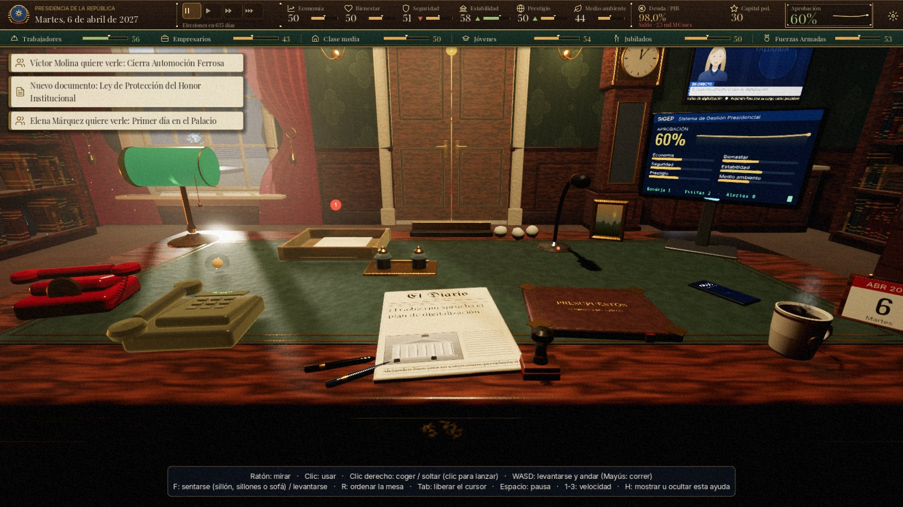
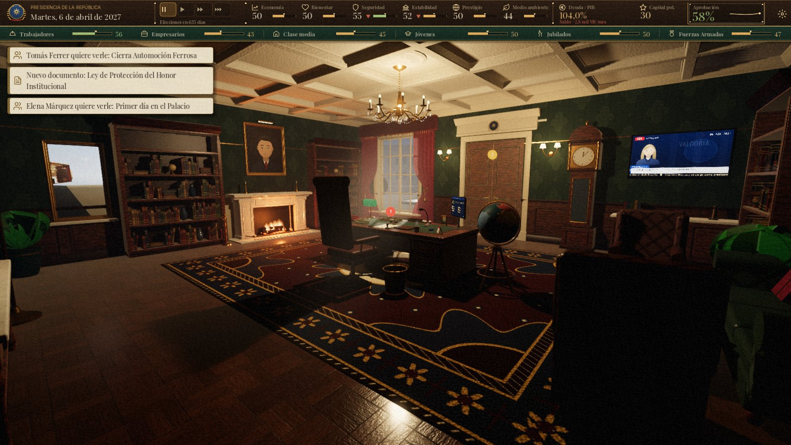
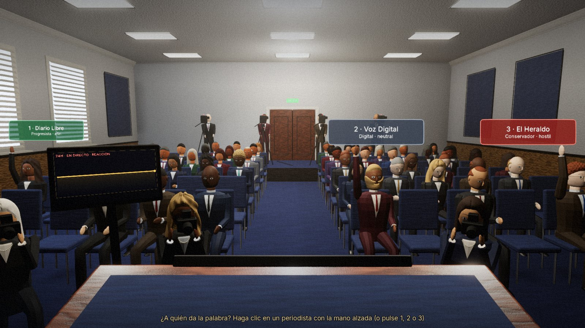
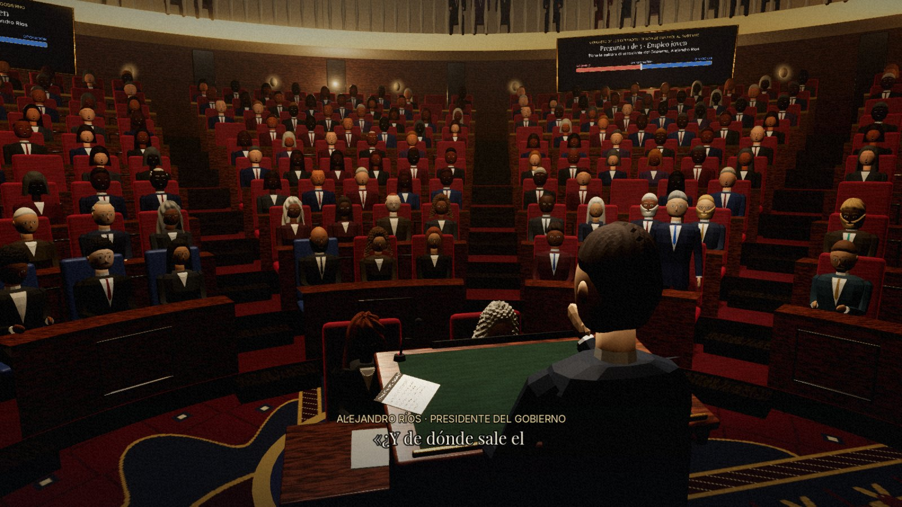
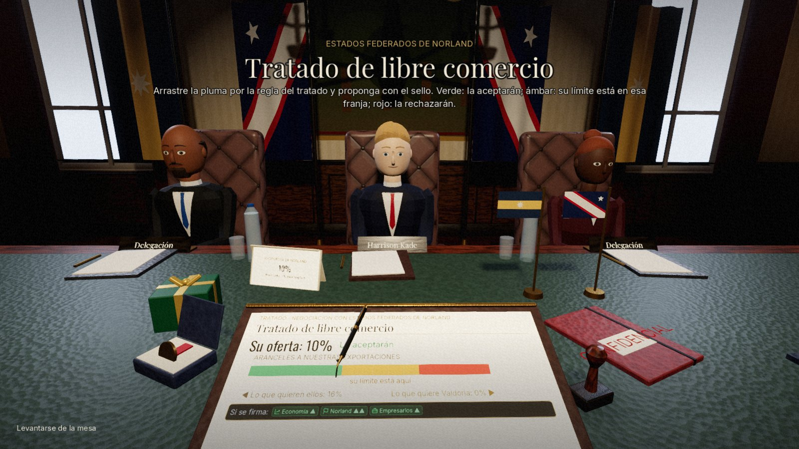
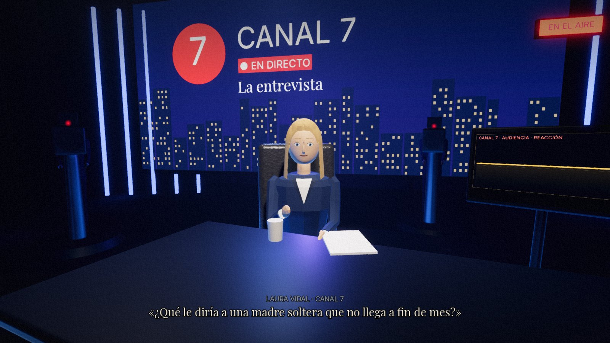
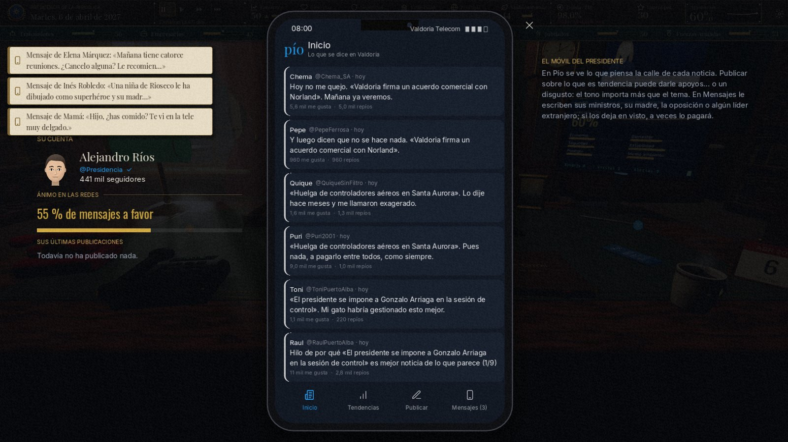
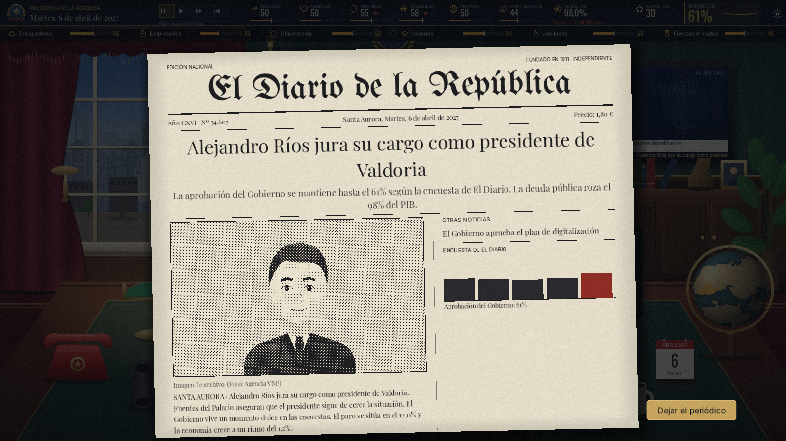
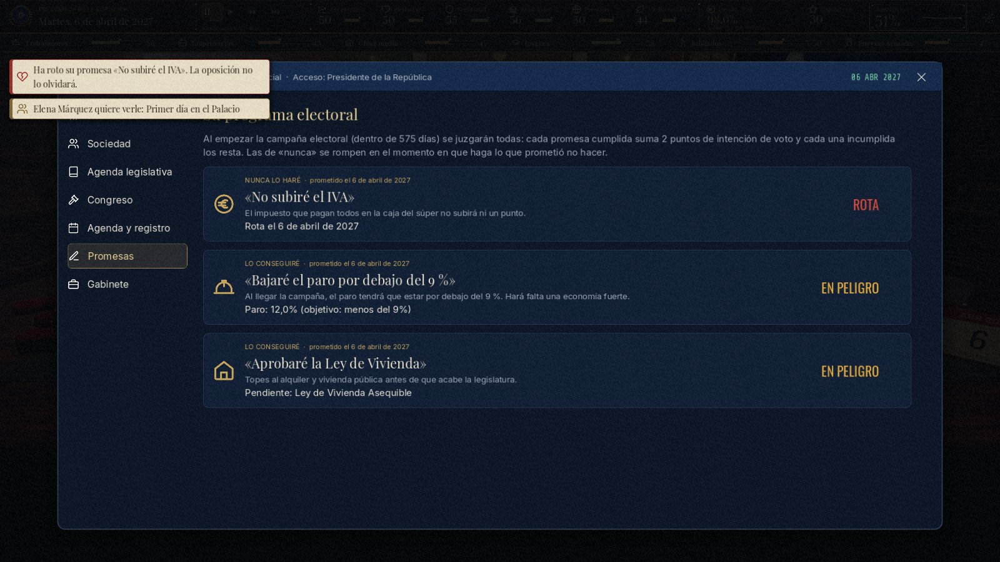

# El Despacho — Simulador presidencial

[](https://godotengine.org/download)


**Eres el nuevo presidente de la República de Valdoria.** Tienes una legislatura para gobernar, sobrevivir a las
crisis, negociar con el mundo y ganar la reelección. Todo ocurre desde tu despacho: firmas leyes con el sello,
recibes a los ministros que llaman a la puerta, contestas el teléfono rojo, das ruedas de prensa y te juegas el
cargo en el Congreso.



- **Un despacho en 3D en primera persona** que se puede recorrer, con objetos que se cogen y se lanzan (y el despacho
  2D clásico, si lo prefieres).
- **Minijuegos dentro de la escena**: rueda de prensa, entrevista en el plató, negociaciones y cumbres, y la sesión
  de control en el hemiciclo, sin ventanas de opciones.
- **Cada partida es distinta**: escenarios, tramas, mundo aleatorio, memoria de tus diez últimas partidas y
  situaciones generadas por piezas.
- **Decisiones que vuelven**: promesas electorales, personajes con memoria, la red social Pío y respuestas escritas
  con tus propias palabras.
- **Todo generado por código**: el arte, la música y los efectos de sonido; los personajes 3D salen de un script de
  Blender.

## Índice

- [Capturas](#capturas)
- [Cómo jugar](#cómo-jugar)
- [Controles](#controles)
- [La partida](#la-partida)
- [El despacho](#el-despacho)
- [Minijuegos](#minijuegos)
- [Sistemas de la versión 3.0](#sistemas-de-la-versión-30)
- [Tienda del Palacio y logros](#tienda-del-palacio-y-logros)
- [Consejos](#consejos)
- [Opciones y gráficos](#opciones-y-gráficos)
- [Partidas guardadas y datos](#partidas-guardadas-y-datos)
- [Para desarrolladores](#para-desarrolladores)
- [Historial de versiones](#historial-de-versiones)
- [Créditos y licencias](#créditos-y-licencias)

## Capturas

**En 3D**

| | |
|---|---|
|  |  |
|  |  |
|  |  |

**Paneles y despacho 2D**

| | |
|---|---|
|  |  |
|  |  |
|  |  |
|  |  |
|  |  |
|  |  |

## Cómo jugar

### Requisitos

- **[Godot 4.7](https://godotengine.org/download)**, versión estándar (no la de .NET). No hace falta nada más: ni
  plantillas, ni complementos, ni conexión a internet.
- Cualquier equipo que mueva Godot. Sin tarjeta gráfica (máquinas virtuales, el controlador básico de Windows...)
  el juego cambia solo al motor *Compatible* y baja la calidad gráfica (ver [Opciones y gráficos](#opciones-y-gráficos)).

### Windows

Haz doble clic en **`Jugar.bat`**. Busca Godot (`Godot_v4*_win64.exe`) en `%USERPROFILE%\Godot\` y, si no está
allí, en la carpeta de Descargas. Antes de abrir el juego importa los recursos si es la primera vez o si hay alguno
nuevo o cambiado (por ejemplo, personajes regenerados con Blender).

### Cualquier sistema

Abre `project.godot` con Godot y pulsa **F5**, o desde una terminal en la carpeta del proyecto:

```sh
godot --path .
```

> [!IMPORTANT]
> Si cambias algún recurso de `art/`, `audio/` o `fonts/` (por ejemplo, después de regenerar los personajes con
> Blender), ábrelo una vez en el editor de Godot o ejecuta `godot --headless --path . --import`. Si no, el juego
> usa los recursos importados antes y faltan animaciones. `Jugar.bat` ya lo hace solo.

### Crear un ejecutable

En Godot: *Proyecto → Exportar → Añadir… → Windows Desktop* (o Linux, o macOS). La primera vez pedirá descargar
las plantillas de exportación. Las exportaciones (`export/`, `export_presets.cfg`) no se suben al repositorio.

## Controles

### Generales

| Tecla | Acción |
|---|---|
| **Espacio** | Pausar / reanudar el tiempo |
| **1 / 2 / 3** | Velocidad del tiempo |
| **Esc** | Menú de pausa (con un panel abierto, lo cierra) |
| **F11** | Pantalla completa |
| **L** | En los documentos: la lupa que revela la letra pequeña |
| **1 – 4** | En las visitas: elegir una opción |

### Despacho 3D

| Control | Acción |
|---|---|
| Ratón | Mirar |
| Clic | Usar el objeto apuntado (abre su panel) |
| Clic derecho | Coger / soltar un objeto (con un objeto en la mano, clic para lanzarlo y rueda para acercarlo o alejarlo) |
| WASD / flechas | Levantarse y andar (**Mayús**: correr) |
| F | Sentarse en el sillón, los sillones o el sofá / levantarse (o clic en el sillón) |
| R | Ordenar la mesa (todo vuelve a su sitio) |
| Tab | Liberar el cursor para usar los botones de la barra superior |
| H | Mostrar u ocultar la ayuda de controles |

### Minijuegos 3D

Se elige con el ratón **sobre cosas de la propia escena** (tarjetas, periodistas, la pluma, el sello...) o con las
teclas **1, 2, 3...**. Un clic en cualquier otro sitio salta el subtítulo que se está leyendo. En las negociaciones,
la oferta también se mueve con la **rueda del ratón** o **← →**.

## La partida

### Nueva legislatura

Eliges nombre y aspecto del presidente, partido, modo, duración, dificultad y escenario inicial; después, antes de
jurar el cargo, tus **promesas electorales**.

| Partido | Perfil |
|---|---|
| Movimiento Progresista (MP) | Centro-izquierda. Fuerte entre trabajadores y jóvenes; recelo empresarial. |
| Centro Cívico (CC) | Centro liberal. Gusta a la clase media; debe pactar a izquierda o derecha. |
| Alianza Republicana (AR) | Centro-derecha. Apoyo de empresarios, jubilados y militares. |

En el Congreso hay siete grupos y 350 escaños: la mayoría absoluta está en **176**.

### Modos de juego

| Modo | Cómo es |
|---|---|
| Clásico | Una legislatura de **1 año** (partida rápida, unos 40 min), **2 años** (recomendado, unos 80 min) o **4 años** (unas 2 h 30 min). Gana la reelección. |
| Infinito | Legislaturas de 4 años, una tras otra. Si ganas, el Congreso sale de las urnas, llegan tramas nuevas y la oposición puede cambiar de líder. Cada legislatura pesa más que la anterior (fatiga y ganas de cambio), así que siempre hay un final. Tu récord de años en el poder queda guardado. |
| Meme | Política de chiste con personajes inventados: la tortilla con o sin cebolla, el plasma, el máster fantasma, el expresidente Galbana y sus frases, plagas de palomas, la caída nacional del wifi... |
| Reto del día | Desde el menú: la misma partida para todos ese día. Ver [Reto del día](#reto-del-día). |

### Dificultad

Cambia la forma de jugar, no solo los números.

| | Fácil | Normal | Difícil |
|---|---|---|---|
| Sistemas | Se presentan poco a poco (discursos, leyes, diplomacia, presupuestos) | Poco a poco, algo más rápido | Todo desde el primer día |
| Ayuda | El gabinete marca la opción más favorable | — | Los efectos solo muestran su dirección, sin cifras ni tendencias |
| Plazos | Más largos | Normales | Más cortos |
| Congreso y mercados | Socios más dóciles; quiebra al 170 % de deuda | Quiebra al 155 % | Socios exigentes, mercados duros; quiebra al 140 % |

### Cada partida es distinta

- **Escenario inicial** (elige uno o déjalo al azar): legislatura tranquila, gran recesión, bonanza, gobierno en
  minoría, herencia envenenada, tras la catástrofe, las Islas quieren votar, vientos de guerra o crisis energética.
- **Tramas**: trece historias de varios meses con ramificaciones (la huelga de controladores, espías en el móvil, la
  burbuja inmobiliaria, la conspiración interna, la tesis del presidente, el tren de Altamira...). Cada partida
  sortea unas pocas.
- **Mundo aleatorio**: ministros, rasgos, carácter de los líderes extranjeros, relaciones y escaños cambian en cada
  partida.
- **Memoria entre partidas**: lo que salió en tus diez últimas partidas sale cada vez menos (mucho menos cuanto más
  reciente). Cuando lo escrito a mano ya salió hace poco, se genera una **situación nueva combinando piezas**:
  alcaldes que piden algo, empresas que quieren invertir, protestas, polémicas, sucesos, propuestas de ministros,
  visitas de famosos y propuestas de otros países.
- **Consecuencias**: eventos que dependen del estado del país y de las leyes que hayas aprobado.

En diez partidas seguidas, de una a la siguiente se repite menos del 20 % de lo que sale.

<details>
<summary><b>El contenido, en cifras</b></summary>

| Contenido | Cantidad |
|---|---|
| Eventos escritos a mano (visitas, documentos, llamadas, crisis y noticias) | 466 |
| Tipos de crisis | 20 (3 de ellos del modo meme) |
| Leyes de la agenda legislativa | 26 |
| Escenarios iniciales · tramas | 9 · 13 |
| Países · regiones de Valdoria · partidos | 7 · 8 · 7 |
| Rasgos de los ministros | 16 |
| Promesas electorales | 35 (y 3 del modo meme) |
| Conversaciones en el móvil | 37 |
| Recuerdos de los personajes (plantillas) | 50 |
| Reglas del reto del día | 20 |
| Piezas para generar leyes menores, cartas, indultos y obras | 115 · 60 · 53 · 66 |
| Objetos de la tienda · logros | 45 · 24 |

</details>

## El despacho

Todo es interactivo, tanto en 3D como en 2D.

| Objeto | Qué hace |
|---|---|
| Bandeja de entrada | Leyes, decretos, indultos, contratos y cartas. Arrastra el **sello** para decidir. Usa la **lupa (L)** para leer la letra pequeña: esconde trampas y corrupción. |
| Puerta | Tus ministros llaman con dilemas urgentes (algunos con cuenta atrás); en 3D **entran por la puerta** y caminan hasta tu mesa. Sin visitas, convocas al Consejo de Ministros: informe, rasgos de cada ministro y **ceses y fichajes**. |
| Teléfono | Llamadas de líderes mundiales y sindicatos. Sin llamada entrante, abre tu agenda para **negociar**. |
| Teléfono rojo | Crisis: abre el **Gabinete de Crisis** (despliegue de unidades en tiempo real sobre el mapa). |
| Ordenador (SIGEP) | Datos, grupos sociales, **agenda legislativa** (presentar leyes), Congreso (reunirse con los partidos), agenda, **promesas** y gabinete. |
| Globo | Mapa diplomático: tratados, visitas de Estado, ayudas, sanciones. |
| Micrófono | Discurso a la nación (minijuego de ritmo con el teleprompter). En campaña abre el **mapa de campaña por regiones**. |
| Móvil | La red social **Pío** y los mensajes privados. |
| Carpeta de cuero | Presupuestos Generales: gasto por partidas e impuestos. |
| Periódico, TV, calendario, reloj, café | Noticias, encuestas, agenda... y un café para el estrés. |
| Mascota | Si has comprado una en la tienda (gato, perro, loro, pez o tortuga), haz clic para bajar el estrés. |
| Ventana | Refleja el estado del país: manifestaciones, disturbios, fuegos artificiales, clima. |

En el **despacho 3D** empiezas sentado en el sillón presidencial y puedes levantarte para andar por toda la sala
(chimenea, librerías, sofá, ventana con vistas a la ciudad, banderas, mapa del mundo, reloj de pie...). El periódico,
los teléfonos, la carpeta, la taza, el calendario, las plumas, el sello, los libros o los cojines se pueden coger,
lanzar y tirar al suelo; hay una papelera donde encestar bolas de papel, los teléfonos dan saltitos cuando suenan y
el retrato oficial que cuelga sobre la chimenea es el tuyo.

## Minijuegos

- **Mesa de firmas**: sellos físicos, lupa de revelado, expedientes de presos y concursos públicos.
- **Negociación**: fijas tu oferta sobre una regla de colores. Verde: la aceptarán; ámbar: su límite está en esa
  franja; rojo: la rechazarán. Tienes 3 intentos y 3 comodines de un solo uso (halagar, presionar, ofrecer algo a
  cambio). Si no quieres arriesgar, acepta su propuesta.
- **Cumbres internacionales**: la misma negociación con tres líderes a la vez (clima, fronteras, energía y libre
  comercio). El acuerdo solo se firma si convence a todos.
- **Sesión de control**: cada mes o dos, cara a cara con el líder de la oposición. Cinco preguntas, réplica
  contrarreloj y combos de aciertos.
- **Gabinete de Crisis**: incendios, pateras, huelgas, pandemia, terrorismo, apagones, sequía, terremoto,
  ciberataques, golpe de Estado, guerra...
- **Congreso**: hemiciclo de 350 escaños, negociación de apoyos (enmiendas, inversión regional o presión) y votación
  escaño a escaño.
- **Rueda de prensa y entrevista**, **discurso** con teleprompter y **debate electoral** cara a cara.
- **Campaña por regiones**: en los últimos 60 días repartes actos (mitin, visita, anuncio de inversión, spot de TV)
  por las 8 regiones del mapa. Cada región suma a su resultado electoral.
- **Noche electoral** con escrutinio región a región.

### Los minijuegos en 3D

Los cuatro minijuegos de hablar y negociar son **escenas 3D en primera persona, sin ventanas ni monitores con las
opciones**. Lo que dicen los personajes sale en **subtítulos**, la pregunta que hay que contestar queda escrita
arriba, el tiempo es una **luz en el borde del atril** (o de la mesa) que se apaga y, al acabar, un rótulo pequeño
resume el resultado. Al mover el ratón, la cámara mira un poco hacia él.

- **Rueda de prensa**: desde el atril, ante periodistas, fotógrafos con flash y cámaras de televisión. **Tres
  periodistas alzan la mano** con la acreditación de su medio (roja si es hostil, verde si es afín, gris si es
  neutral) y **das la palabra con un clic**: los hostiles castigan las evasivas y aplauden ir al ataque, los afines
  te lo ponen fácil. Las respuestas son **tarjetas sobre el atril**, cada una con su tono (sincero, evasivo, firme,
  con humor, al ataque); la sala asiente, se ríe o murmura, y la reacción de la opinión pública sale en el monitor
  de la tarima. El discurso a la nación se ve por televisión desde el fondo de la sala.
- **Entrevista**: en el plató de Canal 7, frente a la entrevistadora, con cámaras, focos, el cartel de «En el aire» y
  la pantalla gigante. Las respuestas son tarjetas sobre la mesa; ella asiente, se ríe o se cruza de brazos, y la
  audiencia en directo sale en el monitor del plató.
- **Negociaciones**: sentado a la mesa frente al otro líder, con sus asesores, sus banderas y su placa. La oferta se
  fija **arrastrando la pluma por la regla del tratado** y **el otro reacciona en directo**: sonríe en verde, frunce
  el ceño en ámbar y se cruza de brazos en rojo. **Se propone con el sello**, **su propuesta es un cartel** de su lado
  de la mesa que se firma con un clic y los comodines son **objetos de la mesa**: la condecoración en su estuche
  (halagar), el dosier «Confidencial» (presionar) y un regalo (ofrecer algo a cambio). Con acuerdo, firma y te tiende
  la mano entre flashes; sin acuerdo, se levanta y se va. En las **cumbres**, mesa redonda con los tres líderes, una
  fila de la regla para cada uno, y eliges a quién dirigirte con un clic (un foco lo ilumina).
- **Sesión de control**: desde la tribuna del hemiciclo, con la Mesa, la galería y unos 330 diputados. La presidenta
  de la Cámara da la palabra y **el líder de la oposición se pone en pie y te señala**; en tu atril esperan **tres
  tarjetas con las réplicas** y la **chuleta del gabinete** (qué réplica va mejor contra cada tipo de ataque). Si la
  réplica es buena, **¡ZASCA!**: tu bancada se pone en pie y aplaude y el resto del hemiciclo bota en sus escaños; si
  es mala, la oposición se ríe y abuchea. Los marcadores bajo la galería llevan la pregunta, quién tiene la palabra,
  el **aplausómetro** y el combo.

En **Opciones** puedes jugar los minijuegos en 3D o con los fondos 2D de siempre, por separado del despacho (despacho
2D con minijuegos 3D, o al revés).

### Tu Gobierno

Cada ministro tiene rasgos (Negociador, Austero, Tecnócrata, Veterano, Polémico, Derrochador...) que cambian la
partida: más dinero cada mes, más tiempo en la sesión de control, unidades extra en las crisis, etc. Puedes cesar a
un ministro (cuesta capital político y estabilidad) y elegir a su sustituto entre tres candidatos.

## Sistemas de la versión 3.0



### Promesas electorales

Antes de jurar el cargo eliges hasta tres de las seis que se ofrecen (distintas en cada partida). Las de «nunca»
(«No subiré el IVA», «Las pensiones no se tocan»...) se rompen en cuanto haces lo contrario; las de objetivo
(«Bajaré el paro por debajo del 9 %») se juzgan al empezar la campaña. Cada promesa cumplida suma votos y cada una
incumplida los resta, y la oposición y la prensa te las recuerdan. Las sigues en la pestaña «Promesas» del ordenador.

### Personajes con memoria

Lo que haces vuelve meses después. El exministro que cesaste va a las tertulias, escribe sus memorias o ficha por la
oposición; el indultado reincide (o abre un comedor social); quien te escribió una carta vuelve a escribir; las obras
que adjudicaste se inauguran, se encarecen o acaban en el juzgado; los líderes extranjeros empiezan la llamada
recordando que no les cogiste el teléfono; y cada partida tiene una **periodista incómoda** que te recuerda lo que le
contestaste.

### El móvil del presidente

Está sobre la mesa (en 3D también se puede coger). Dentro está **Pío**, la red social de Valdoria: lo que dice la
gente de cada noticia, las tendencias y tus publicaciones, que según el tema y el tono se hacen virales o provocan un
incendio. Y los **mensajes privados**: tu madre, la Jefa de Gabinete, los ministros, la oposición, la periodista,
líderes extranjeros y tu jefe de comunicación. Si los dejas en visto, a veces se paga.

### Reto del día

La misma partida para todos cada día (presidente, partido, escenario y tres promesas obligatorias) con dos reglas
especiales de veinte posibles. Se guarda tu mejor puntuación del día y la racha.

### Responder con tus propias palabras

En las visitas y en las llamadas puedes escribir lo que dirías. El juego lo entiende **sin internet**, con reglas
(`scripts/data/interprete_reglas.gd`): a qué opción se parece, negaciones («no pienso rescatar a nadie»), «la
segunda», un «vale» a lo que te recomiendan, pedir tiempo o un informe (vuelve en unos días y con el informe ves los
efectos ocultos), delegar, bromas, insultos y órdenes turbias, y el tono. Está preparado para conectar una IA más
adelante a través de un servidor propio (ver `scripts/systems/interprete.gd`).

## Tienda del Palacio y logros

- Ganas **Laureles** jugando: leyes aprobadas, crisis bien resueltas, acuerdos, debates, cumbres, logros y una
  recompensa al final de cada legislatura.
- El escaparate cambia **cada día**, con un artículo destacado rebajado un 30 %.
- Personaliza la bandera nacional, el estilo del despacho, la madera del escritorio, el teléfono rojo, el globo, la
  lámpara, el traje, la corbata, los accesorios (pin, banda, medalla), la tinta de los sellos y la mascota.
- **24 logros** con recompensa.
- **Lingotes** (moneda premium): funcionan en **modo de prueba**, sin cobros reales. `scripts/autoload/payments.gd`
  explica cómo conectar Steam o Stripe cuando se publique el juego (los cobros reales deben validarse siempre en un
  servidor, nunca solo en el cliente).

## Consejos

- Si te limitas a esperar, el **desgaste del poder** te hundirá. Aprueba leyes, cuida a tus socios (relación ≥ 60 en
  el Congreso) y habla al país. Para gobernar, tu partido debe ser el más votado de su bloque.
- Vigila la **deuda** (quiebra al 155 % en normal), la **estabilidad** (moción de censura) y la moral de las
  **Fuerzas Armadas** (golpe de Estado).
- Las decisiones turbias suman **corrupción**: no se ve, pero acaba saliendo en forma de escándalo. Junto al capital
  político verás el riesgo (en fácil y normal).
- Cuidado con lo que prometes: una promesa de «nunca» se rompe en el mismo momento en que haces lo contrario.
- La partida se guarda automáticamente cada mes (y cuando quieras, desde el menú de pausa).

## Opciones y gráficos

Desde el menú principal o el menú de pausa:

| Opción | Qué hace |
|---|---|
| Volumen general, música y efectos | Mezcla de audio |
| Velocidad del texto | De 0,5× a 3× |
| Sensibilidad del ratón | Para mirar en el despacho 3D |
| Pantalla completa | También con **F11** |
| Grano cinematográfico | El filtro de película sobre la imagen |
| Despacho en 3D | Desactívalo para volver al despacho 2D clásico (se cambia al momento) |
| Minijuegos en 3D | Rueda de prensa, entrevista, Congreso y negociaciones en 3D o con los fondos 2D |
| Calidad gráfica | Automática, Baja, Media, Alta o Ultra |
| Motor gráfico | Automático, Avanzado (Forward+) o Compatible (sin tarjeta gráfica) |

- El proyecto usa **Forward+** por defecto. Al arrancar, si no hay aceleración gráfica (máquina virtual, controlador
  básico de Windows, llvmpipe...), cambia solo al motor **Compatible** y se reinicia una vez. El motor elegido se
  guarda en `override.cfg`, junto a `project.godot` (o junto al ejecutable exportado).
- **Alta** y **Ultra** necesitan el motor avanzado y una tarjeta gráfica: añaden iluminación global (SDFGI),
  oclusión ambiental, reflejos, niebla volumétrica y rayos de luz. **Baja** reduce la resolución 3D y quita sombras,
  partículas y luces secundarias. En automático: Alta con Forward+, Media con el motor compatible y Baja sin tarjeta
  gráfica.
- La primera vez que se abre el despacho 3D se generan sus texturas (madera, cuero, latón, lomos de libros...) y se
  guardan para las siguientes.

## Partidas guardadas y datos

Todo se guarda en la carpeta de datos de Godot para este proyecto (`user://`):

| Sistema | Carpeta |
|---|---|
| Windows | `%APPDATA%\Godot\app_userdata\El Despacho\` |
| Linux | `~/.local/share/godot/app_userdata/El Despacho/` |
| macOS | `~/Library/Application Support/Godot/app_userdata/El Despacho/` |

| Archivo | Contenido |
|---|---|
| `partida.json` | La partida en curso (se guarda sola cada mes y desde el menú de pausa) |
| `perfil.json` | Laureles, lingotes, colección, logros, estadísticas, récords del reto del día y la memoria de tus últimas partidas (separado de la partida) |
| `settings.cfg` | Las opciones |
| `tex3d/` | Texturas del despacho 3D generadas la primera vez |

Para empezar de cero, borra esa carpeta con el juego cerrado.

## Para desarrolladores

El juego está escrito entero en GDScript y casi no usa escenas del editor (solo `scenes/main.tscn`): cada pantalla,
panel y escenario se construye por código. La única herramienta en otro lenguaje es el generador de personajes, en
Python para Blender.

### Estructura del proyecto

```
├── Jugar.bat                 lanzador para Windows (busca Godot e importa si hace falta)
├── project.godot
├── scenes/main.tscn          escena raíz (scripts/main.gd)
├── scripts/
│   ├── main.gd               pantallas, paneles, transiciones, atajos y modos de prueba
│   ├── autoload/             UI (tema y widgets), Sfx (audio y opciones), DB (datos), GS (estado y
│   │                         simulación), Payments (pagos) y Perfil (monedas, logros, memoria)
│   ├── data/                 contenido: eventos, mundo, prensa, escenarios y tramas, tienda, promesas,
│   │                         móvil, memoria, reto, plantillas, generadores y reglas del intérprete
│   ├── systems/              sistemas de la 3.0: promesas, memoria, redes, reto, interprete, plantillas
│   ├── screens/              menú, nueva partida, promesas, tienda, pantalla final y fondo
│   ├── overlays/             cada minijuego y panel (documentos, asesor, llamadas, negociación, crisis...)
│   ├── office/               el despacho 2D: arte vectorial por código, ventana, TV, monitor y HUD
│   ├── office3d/             el despacho 3D
│   ├── stages3d/             los escenarios 3D de los minijuegos
│   ├── ui/                   componentes: mapa, retratos, banderas, avisos, opciones, máquina de escribir...
│   ├── autotest.gd           simulación de partidas sin interfaz
│   ├── uitest.gd             prueba de humo de la interfaz
│   └── interptest.gd         prueba de las respuestas escritas
├── shaders/                  2D (papel, tinta, mapa, grano...) y 3D (*3d.gdshader: cielo, fuego, banderas...)
├── art/characters/           personajes 3D (visitor.glb, crowd.glb), generados con Blender
├── art/maps/                 mapas del mundo y de Valdoria (PNG de identificadores + JSON)
├── audio/                    música y efectos, generados por código
├── fonts/                    tipografías y sus licencias
├── tools/                    generadores de audio, mapas y personajes
└── docs/capturas/            las imágenes de este README
```

**El despacho 3D** (`scripts/office3d/`): `office_3d.gd` (lógica, objetos y calidad gráfica), `room_3d.gd` (la sala),
`exterior_3d.gd` (la ciudad tras la ventana), `player.gd` (primera persona, coger y lanzar), `visitor_3d.gd`,
`interactable.gd`, `paper_views.gd` (periódico y papeles), las mascotas (`cat_3d.gd`, `dog_3d.gd`, `parrot_3d.gd`,
`fishbowl_3d.gd`, `aquarium_3d.gd`), `kit.gd` (geometría y materiales) y `tex3d.gd` (texturas generadas por código).

**Los escenarios 3D** (`scripts/stages3d/`): `stage_3d.gd` es la base (cámara, personajes, luces, objetos que se pulsan
con `add_pick()`, tarjetas con `deal_cards()`, subtítulos con `say()`, cita con `caption()`, golpes de efecto con
`big_text()`, luz del tiempo con `time_strip()`, rótulo final con `end_card()` y pantallas dentro de la escena con
`screen()`); además `card_3d.gd` (las tarjetas), `press_room_3d.gd`, `studio_3d.gd`, `nego_room_3d.gd`,
`congress_3d.gd` y `crowd_3d.gd` (el público lejano).

**Los datos de la 3.0** (`scripts/data/`): `promises_data.gd`, `memoria_data.gd`, `social_data.gd`, `reto_data.gd`,
`interprete_reglas.gd`, `plantillas_data.gd`, `generadores_data.gd`, `conversaciones_data.gd`, `events_v3a.gd` y
`events_v3b.gd`. Los eventos anteriores están en `events_data.gd`, `events_tramas.gd` (tramas), `events_extra.gd` y
`events_meme.gd` (modo meme); los escenarios y tramas, en `scenarios_data.gd`.

### Pruebas automáticas

Simulan partidas enteras sin interfaz y no tocan tu perfil ni tu partida guardada:

```sh
godot --headless --path . -- --check                        # compila todos los scripts
godot --headless --path . -- --autotest=730 --runs=30 --strategy=player --difficulty=1
godot --headless --path . -- --autotest=9125 --runs=20 --mode=infinito --strategy=casual
godot --headless --path . -- --autotest=270 --variety=30    # cuánto se parecen las partidas entre sí
godot --headless --path . -- --autotest=365 --runs=20 --daily --strategy=casual   # retos de los próximos días
godot --headless --path . -- --interptest                   # prueba las respuestas escritas
godot --headless --path . -- --uitest                       # abre y prueba cada pantalla (unos 10 min)
```

| Opción de `--autotest=días` | Valores |
|---|---|
| `--strategy=` | `random` (al azar), `smart` (lo mejor para su electorado, sin leyes), `casual` (jugador medio), `player` (jugador experto) y `worst` (siempre lo peor) |
| `--difficulty=` | `0` fácil, `1` normal, `2` difícil |
| `--mode=` | `clasico`, `infinito` o `meme` |
| `--runs=N` | Número de partidas (con más de una, solo sale el resumen) |
| `--variety=N` | N partidas seguidas con memoria entre ellas; mide cuánto se repiten |
| `--daily` | Juega los retos del día de los próximos días |

> [!TIP]
> Para no tocar tus datos al probar a mano, cambia la carpeta de datos de Godot antes de lanzarlo; en Windows,
> por ejemplo, `set APPDATA=%TEMP%\despacho-pruebas` en la misma consola.

### Capturas de prueba

Con `--shot` el juego no guarda nada y el ratón y el teclado reales no mueven nada:

```sh
godot --path . -- --shot=office --pngshot=despacho.png                       # el despacho 3D
godot --path . -- --shot=office --cam=3.6,0,3.4,40,-8 --pngshot=sala.png     # de pie: x,y,z,giro,inclinación
godot --path . -- --shot=office --open=pressrun --stageshot=prensa.png       # un escenario 3D
godot --path . -- --shot=office --open=controlrun --stageframes=200,400,600 --stageshot=hoja.png
```

<details>
<summary><b>Todas las opciones de captura</b></summary>

| Opción | Qué hace |
|---|---|
| `--shot=office` | Partida de prueba en el despacho. También `menu`, `reto`, `opciones`, `shop`, `start`, `newgame` y `promesas` |
| `--open=panel` | Abre un panel nada más empezar: `doc`, `contract`, `advisor`, `call`, `nego`, `summit`, `campaign`, `control`, `controlrun`, `controlreply`, `controlzasca`, `hire`, `crisis`, `crisisrun`, `vote`, `press`, `pressrun`, `interview`, `interviewrun`, `speech`, `debate`, `diary`, `movil`, `movilpub`, `movilchat`, `moviltrend`, `memocall`, `memovisit`, `preface`, `custom`, `custom2`, `promesas`, `night`, `live`, `election`, `ending`... |
| `--pngshot=archivo.png` | Guarda una captura del despacho 3D y cierra el juego |
| `--cam=x,y,z,giro,inclinación` | Pone al presidente de pie en ese punto del despacho 3D |
| `--stageshot=archivo.png` | Guarda una captura del escenario 3D abierto y cierra el juego (`--stagewait=n`: tras n fotogramas; 90 por defecto) |
| `--stageframes=f1,f2,...` | Una hoja con varias capturas de la misma partida |
| `--stageclick=x,y,fotograma` | Simula un clic en ese punto (se puede repetir) |
| `--stagekey=n,fotograma` | Simula la tecla n |
| `--stagemouse=x,y` | Deja el ratón quieto en ese punto |
| `--gfx=baja\|media\|alta\|ultra` | Fuerza la calidad gráfica |
| `--nofx=sdfgi,fog,ssr,ssil,ssao,probe` | Desactiva efectos concretos |
| `--pet=gato\|perro\|loro\|pez\|tortuga` | Pone esa mascota |
| `--dmode=` · `--ddiff=` · `--dscen=` | Modo, dificultad y escenario de la partida de prueba |
| `--fps` · `--nograin` · `--nolight` | Muestra los FPS en la consola · quita el grano · apaga la luz del despacho |
| `DOC=id` · `CRISIS=id` | Variables de entorno: el documento o la crisis que abren `--open=doc` y `--open=crisis` |

</details>

### Generar los recursos

La música, los efectos, los mapas y los personajes no se dibujan ni se graban: se generan con estas herramientas
(sus resultados ya están en el repositorio).

```sh
godot --headless --path . --script res://tools/gen_audio.gd    # música y efectos  → audio/
godot --headless --path . --script res://tools/gen_maps.gd     # mapas             → art/maps/
blender -b --factory-startup -P tools/blender/gen_characters.py -- [salida.glb] [carpeta_de_vistas_previas]
```

`gen_characters.py` (Blender 5.2) crea `art/characters/visitor.glb`, con todas las piezas de los visitantes y sus
animaciones (andar, hablar, sentarse y los gestos de los escenarios: señalar, reírse, celebrar, abuchear, el atril,
asentir, negar, cruzarse de brazos, leer, firmar, tender la mano, el mazo...), y `crowd.glb`, los diputados lejanos
del hemiciclo. Con `PREVIEW_ONLY=stage` solo saca la hoja de posturas de los escenarios y con `PREVIEW_SET=gestos`, la
de gestos. Después, vuelve a importar el proyecto (`godot --headless --path . --import`).

### Integraciones pendientes

- **Pagos reales**: `scripts/autoload/payments.gd` (Steam o Stripe, siempre validando en un servidor propio).
- **IA para las respuestas escritas**: `scripts/systems/interprete.gd` describe el formato que debe devolver el
  servidor; la clave de la IA nunca debe ir dentro del juego.

## Historial de versiones

- **Despacho 3D**: el despacho en primera persona con objetos con físicas y los cuatro minijuegos de hablar y
  negociar como escenas 3D sin ventanas de opciones. Opciones separadas para el despacho y los minijuegos 3D, calidad
  gráfica de Baja a Ultra y cambio automático de motor gráfico en equipos sin aceleración.
- **3.0**: promesas electorales, personajes con memoria, el móvil del presidente (Pío y mensajes), reto del día,
  respuestas escritas con tus propias palabras y mucha más variedad: memoria de diez partidas, situaciones generadas
  por piezas, unos 80 ataques de la oposición (antes, 8), seis crisis nuevas (sequía, terremoto, marea negra,
  ciberataque a los bancos, temporal de nieve y plaga) y cientos de leyes menores, cartas, indultos y obras.
- **2.0**: modos Clásico, Infinito y Meme; dificultades que cambian la forma de jugar; escenarios iniciales, tramas y
  mundo aleatorio; equilibrio revisado (las decisiones dejan huella durante meses, la corrupción acaba en escándalos y
  cada ley encarece la siguiente) y una barra superior nueva.

## Créditos y licencias

- Código, arte vectorial, texturas, música y efectos de sonido: generados por código para este proyecto. Personajes
  3D: generados con Blender por `tools/blender/gen_characters.py`.
- Tipografías de Google Fonts: Playfair Display, Inter, Oswald, Caveat, UnifrakturMaguntia, Share Tech Mono y Mrs
  Saint Delafield (SIL Open Font License) y Special Elite (Apache 2.0). Sus licencias están en `fonts/licencias/`.
- Hecho con [Godot Engine](https://godotengine.org) (licencia MIT) y Jolt Physics.
- Países, partidos y personajes son ficticios.
